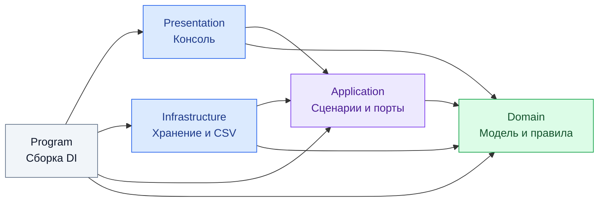

# ПОС

Консольное приложение оценивания на C# и .NET 8: DDD, Hexagonal Architecture,
фабрика оценок, Facade, Strategy, Decorator, DI-контейнер и экспорт CSV.

## Запуск и проверка

Из корня репозитория:

```bash
dotnet run --project HW-2/Pos.csproj
dotnet test HW-2/Tests/Pos.Tests.csproj
```

При запуске выберите формулу: `1` - взвешенная, `2` - среднее долей
выполнения. Затем округление: `0` - без него, `1` - до сотых.
Этот выбор применяется ко всем расчётам и экспорту текущего запуска.

Меню позволяет добавлять и просматривать студентов и критерии, выставлять, исправлять и отменять оценки, считать итог и экспортировать
все итоги. Студент и критерий выбираются по номеру в показанном списке.
Дробные числа принимаются с точкой и запятой. `0` в меню завершает программу,
завершение потока ввода также корректно завершает работу.

### Быстрая демонстрация

```bash
dotnet run --project HW-2/Pos.csproj -- --demo
```

Без ручного ввода выполняется сквозной сценарий ниже.
Используется взвешенная формула без округления. CSV получает уникальное имя
`pos-demo-….csv` во временной папке ОС, полный путь выводится в консоль.

### Сквозной сценарий в консоли

1. При запуске выберите формулу `1` и округление `0`.
2. Команда `1`: добавьте Никиту Пичурина.
3. Команда `3`: добавьте «ДЗ», максимум 10, вес 70.
4. Команда `3`: добавьте «Проект», максимум 20, вес 30.
5. Команда `5`: студент 1, критерий 1, балл 8.
6. Команда `5`: студент 1, критерий 2, балл 15.
7. Команда `6`: студент 1 - просмотр выставленных оценок.
8. Команда `9`: студент 1 - итог 7,85.
9. Команда `10`: укажите новый путь, например `results.csv`.
10. Команда `7`: студент 1, критерий 2, исправляем балл с 15 на 20, новый итог 8,6.
11. Команда `8`: студент 1, критерий 2, отмена, поэтому итог и экспорт недоступны.
12. Команда `5`: выставьте оценку за проект заново, после этого итог снова доступен.

Для демонстрации округления можно выставить за проект 15,123: взвешенный
итог без округления - 7,86845, с округлением - 7,87. Для средней формулы
те же данные дают 7,78075 и 7,78.

## Правила оценок

- Одна текущая оценка на пару "студент + критерий", повторное выставление запрещено.
- Исправление заменяет балл и проходит те же проверки, что выставление.
- Неверное исправление сохраняет предыдущую оценку.
- Отмена удаляет оценку. История изменений пока не ведётся.
- Отсутствующая оценка не равна нулю, те пока не заполнены все критерии,
  итог недоступен..
- Если после выставления оценок добавить критерий, его тоже нужно заполнить.
- Пустой рубрикатор не позволяет вычислить итог.
- Балл находится в диапазоне от 0 до максимума включительно.
- Оценка выставляется только по критерию, находящемуся в рубрикаторе.
- Максимум и вес положительны, названия и имя студента непустые.

Основной расчёт нормализует веса по их сумме и возвращает десятибалльный итог.
Альтернативный режим считает среднее долей выполнения без учёта весов.
Обе формулы требуют полного набора оценок. Формула и округление выбираются
при запуске. Консоль выводит результат без лишних завершающих нулей,
не ограничивая его двумя знаками. Декоратор округляет сам результат до сотых
независимо от выбранной формулы.

## Карта DDD

Используется единый язык: студент (`Student`), критерий (`Criterion`),
рубрикатор (`Rubric`), оценка (`Evaluation`), диапазон баллов (`ScoreRange`).

| Понятие | Роль | Почему |
| --- | --- | --- |
| `Student` | Entity, корень агрегата | Имеет ID и управляет своими оценками |
| `Rubric` | Корень агрегата рубрикатора | Управляет набором критериев, сейчас рубрикатор один, поэтому отдельный ID не нужен |
| `Criterion` | Entity внутри Rubric | Различается по ID, одинаковые названия допустимы |
| `Evaluation` | Неизменяемая запись внутри Student | Текущая оценка определяется парой StudentId + CriterionId, при исправлении запись заменяется |
| `ScoreRange` | Value Object | Определяется максимумом, при этом минимум всегда 0 |
| `FinalScoreCalculator` | Domain Service | Рассчитывает итог по студенту, его оценкам и рубрикатору |

`ScoreRange` объявлен через `record`, поэтому ,например, два `new ScoreRange(10)` равны. `Maximum` доступен только
для чтения, а `Contains` проверяет принадлежность балла диапазону.

`Criterion.Range` хранит этот Value Object. Свойство `MaxScore` оставлено для удобства
и возвращает `Range.Maximum`, поэтому максимум не хранится в двух местах.

Границы агрегатов:

```text
Student                         Rubric
└── Evaluation[]                 └── Criterion[]
                                      └── ScoreRange
```

Оценки меняются через `Student.AddEvaluation`, `CorrectEvaluation` и
`CancelEvaluation`. Коллекция снаружи доступна только для чтения. Это защищает
уникальность оценки даже при вызове домена без Application. Фабрика
`Evaluation.Create` проверяет критерий и балл при создании,
конструктор закрыт, свойства нельзя изменить снаружи.
При исправлении новая запись создаётся и проверяется до замены старой.

### Почему оценки принадлежат Student

По ТЗ не требуется хранить оценки внутри студента, но я выбрал `Student` здесь корнем агрегата, потому что основное правило
согласованности относится к оценкам одного студента, те по каждому критерию
допускается только одна текущая оценка. Выставление, исправление и отмена
проходят через этот корень, поэтому правило защищено в самой модели,
независимо от консоли и Application.

`Evaluation` остаётся отдельным классом и описывает один выставленный балл.
Принадлежность агрегату означает, что набором таких записей управляет `Student`.
При этом `Student` не рассчитывает итог, не выводит данные и не записывает их
в файл. Расчёт выполняет Domain Service, а хранение обеспечивает репозиторий.

Для текущего ядра с одним рубрикатором это позволяет обойтись без отдельной
ведомости и репозитория оценок. Если появятся несколько курсов с независимыми
наборами оценок, эту границу можно переделать ,например, выделить агрегат
ведомости или оценивания студента на конкретном курсе.

Критерии добавляются через `Rubric.Add`, который запрещает повтор одного ID.

## Сценарии и хранение

Выбрана **Hexagonal Architecture**. Слои представлены папками
в одном проекте, а не отдельными сборками.

```text
HW-2/
├── Domain/                      понятия, инварианты, расчёт
│   ├── Student.cs
│   ├── Criterion.cs
│   ├── ScoreRange.cs
│   ├── Rubric.cs
│   ├── Evaluation.cs
│   ├── FinalScoreCalculator.cs
│   ├── IFinalScoreCalculator.cs
│   ├── IFinalScoreStrategy.cs
│   ├── WeightedScoreStrategy.cs
│   ├── AverageScoreStrategy.cs
│   └── RoundedFinalScoreCalculator.cs
├── Application/                 сценарии и порты
│   ├── GradingService.cs
│   ├── IStudentRepository.cs
│   ├── IRubricRepository.cs
│   ├── IFinalScoreExporter.cs
│   └── FinalScoreResult.cs
├── Infrastructure/              реализации хранения
│   ├── InMemoryStudentRepository.cs
│   ├── InMemoryRubricRepository.cs
│   └── CsvFinalScoreExporter.cs
├── Presentation/
│   └── ConsoleApplication.cs     меню, ввод и вывод
├── Program.cs                   выбор режима и DI-контейнер
└── Tests/                       проверки домена и сценариев
```

Зависимости исходного кода (стрелка A -> B означает, что A использует типы из B):



`Domain` не имеет исходящих стрелок: он не зависит от остальных слоёв.
`Infrastructure` реализует порты из `Application`, а `Program` соединяет все части.

Domain не знает о консоли и репозиториях. Application зависит от интерфейсов. `Program` собирает зависимости через DI-контейнер.

`GradingService` предоставляет сценарии: добавить и посмотреть студентов
и критерии, выставить, посмотреть, исправить и отменить оценки, вычислить итог.
Он получает объекты из репозиториев и вызывает доменные операции, а
проверки баллов и дублей здесь уже нету.

Пример программного вызова сценария, если уже получен `GradingService grading`
и созданы объекты `student` и `project`:

```csharp
grading.CorrectEvaluation(student.Id, project.Id, 20);
decimal result = grading.CalculateFinalScore(student.Id);
```

При неизвестном студенте или критерии возникает `ArgumentException`,
при недопустимом балле `ArgumentOutOfRangeException`, при дублировании
оценки и неполном итоге `InvalidOperationException`.

## Паттерны

### Порождающий: статическая фабрика оценок

`Evaluation.Create(student, rubric, criterionId, score)` - единая точка создания
оценки. Метод проверяет аргументы, находит критерий и проверяет диапазон,
после чего вызывает закрытый конструктор. Выставление и исправление в `Student`
используют одну фабрику, поэтому проверка критерия и допустимого балла выполняется одинаково в обоих случаях.

### Структурный: Facade

`GradingService` - фасад сценариев для консоли. Он объединяет работу
репозиториев, агрегатов, калькулятора и экспортёра. `ConsoleApplication` вызывает
методы фасада, включая `GetCriterion`, и не обращается к хранилищам напрямую. Поэтому консоли не нужно знать последовательность поиска объектов
и выполнения доменных операций.

### Поведенческий: Strategy

`IFinalScoreStrategy` задаёт контракт формулы расчёта. Это доменный интерфейс,
он описывает правило вычисления оценки, а не способ хранения или отображения.
`FinalScoreCalculator` получает стратегию через конструктор. Сначала он
проверяет аргументы, непустой рубрикатор и наличие оценки по каждому критерию,
а затем передаёт стратегии рубрикатор и словарь оценок. Стратегии работают
с уже проверенными данными.

- `WeightedScoreStrategy` считает взвешенный итог:
  `10 × сумма(балл / максимум × вес) / сумма(весов)`.
- `AverageScoreStrategy` считает среднее долей выполнения:
  `10 × сумма(балл / максимум) / число критериев`. Критерии равнозначны,
  поэтому назначенные веса в этом режиме намеренно не используются.

Основной режим остаётся взвешенным. Польза Strategy - возможность выбрать
одну из двух формул без изменения сценариев Application и без дублирования
проверок заполненности оценок.

### Структурный: Decorator

`IFinalScoreCalculator` - общий интерфейс обычного и округляющего калькуляторов.
`GradingService` зависит от него, поэтому принимает любой из этих вариантов.
`RoundedFinalScoreCalculator` хранит другой `IFinalScoreCalculator`, вызывает
его и округляет успешный результат до сотых. Проверки и формула остаются
во вложенном калькуляторе.

Без декоратора дополнительного округления нет. В отличие от формата вывода
`0.##`, декоратор меняет возвращаемое значение `decimal`, а не только текст.
Для 1/3 итог без декоратора примерно 3,3333, с декоратором 3,33.

Пример выбора формулы и округления при сборке приложения:

```csharp
var strategy = new AverageScoreStrategy();
var calculator = new FinalScoreCalculator(strategy);
var roundedCalculator = new RoundedFinalScoreCalculator(calculator);
```

Чтобы получить взвешенный округлённый итог, достаточно выбрать
`WeightedScoreStrategy`. Чтобы получить точный результат выбранной формулы,
нужно передать в `GradingService` обычный `calculator` без обёртки.

## DI, консоль и экспорт

В `Program.CreateProvider` используется `Microsoft.Extensions.DependencyInjection`
8.0.1,  та же библиотека, что в ДЗ 1. Контейнер связывает интерфейсы
репозиториев и экспортёра с реализациями, создаёт калькулятор с выбранной
стратегией, при необходимости оборачивает его декоратором и передаёт зависимости
в `GradingService` и `ConsoleApplication`.

Для одного консольного запуска выбран `Singleton`, все команды используют
одни и те же хранилища. Новый репозиторий на каждую команду терял бы ранее
добавленные данные. Контейнер освобождается через `using` при завершении.

`TextReader` и `TextWriter` в консоли это стандартные средства ввода и вывода.
В обычном запуске это `Console.In` и `Console.Out`, в тестах это строки.
Это позволяет проверять настоящее меню без глобальной подмены `Console`.

`IFinalScoreExporter` - выходной порт в Application. Сценарий
`ExportFinalScores` сначала вычисляет все итоги и собирает `FinalScoreResult`
(ID, имя, итог), затем вызывает экспортёр. Если нет студентов или хотя бы
у одного студента отсутствует оценка, файл не создаётся и адаптер не вызывается.

`CsvFinalScoreExporter` - адаптер в Infrastructure. Формат: UTF-8,
разделитель `;`, заголовок `StudentId;StudentName;FinalScore`, десятичная точка
независимо от локали. Сохраняется результат выбранной формулы и декоратора,
в CSV дополнительного округления нет. Имена заключены в кавычки, внутренние
кавычки удвоены. Для имён, которые могли бы интерпретироваться табличной
программой как формулы, добавляется апостроф.

`FileMode.CreateNew` запрещает перезапись существующего файла. Укажите новое
имя, родительская папка должна существовать. Ошибки пути, доступа и записи
показываются в консоли, после чего можно продолжить работу.

## Тесты

```bash
dotnet test HW-2/Tests/Pos.Tests.csproj
```

Тесты написаны на xUnit и проверяют правила доменной модели: допустимые баллы,
запрет повторных оценок, исправление и отмену, а также невозможность расчёта
при пропущенных оценках. Отдельно проверяются обе формулы итога, округление,
работа консольного меню и демо-режима через DI-контейнер, CSV-экспорт и запрет
перезаписи существующего файла.


## Использование ИИ

Я использовал ИИ, как "ревьювера", для проверки покрытия тестов и схожести с условием. Также использовал ИИ в качестве браузера,
уточняя некоторые моменты по синтаксису. Основная логика и модули проекта реализовал самостоятельно, без использования ИИ
